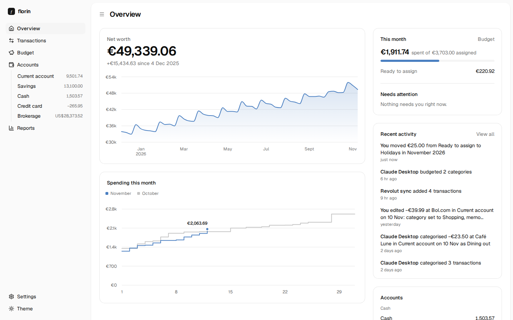
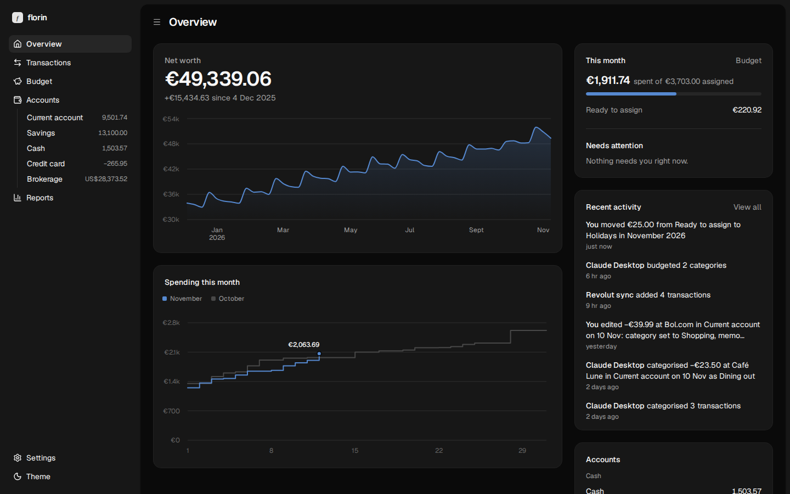

# florin

florin is a budgeting app you run yourself. One `florin` command serves a
calm web dashboard, a JSON API and an MCP server on one local port, over one
SQLite file in `~/.florin`. It does envelope budgeting per category with
leftover carrying over, accounts in any currency, transfers, CSV import and
four reports; it syncs your bank through [Enable Banking](https://enablebanking.com)
and your Interactive Brokers account through IBKR Flex. Agents do most of the
day-to-day work through its MCP server, and every change says who made it.





More: [budget](docs/screenshots/budget-light.png) ·
[transactions](docs/screenshots/transactions-light.png) ·
[investment account](docs/screenshots/investment-light.png) ·
[reports](docs/screenshots/reports-light.png) ·
[activity](docs/screenshots/activity-dark.png) ·
[rules](docs/screenshots/rules-light.png) (all from the built-in demo data).

## Install

On Linux or macOS (x64 or arm64):

```sh
curl -fsSL https://raw.githubusercontent.com/wynn-dev/florin/main/install.sh | sh
```

It needs only curl (or wget), tar and a sha256 tool: the download carries its
own Node, so nothing else is installed and no package manager is involved. The
script checks the download against the release's `checksums.txt`, puts florin
in `~/.local/share/florin/<version>` and links `~/.local/bin/florin` to it. To
install a particular version, end the line with `| FLORIN_VERSION=0.2.0 sh`.

Then run it in the background, now and whenever the machine starts:

```sh
florin service install
```

It prints the address, by default http://127.0.0.1:4680, and on a fresh florin
the setup code the dashboard asks for before you choose a password. To try
florin without a service, `florin start` runs it in the terminal.

## First run

Open the address `florin service install` printed. The first-run page asks for
the setup code (`florin setup-code` prints it again), then takes you through
four short steps: a password and the budget's currency; your accounts (connect
a bank, connect Interactive Brokers, or add one by hand); starter categories
you can rename or untick; and an access token for an MCP client. Every step
after the first can be skipped and done later in Settings.

## The budget

Each month you assign money to expense categories. A category's available
amount is what it had left at the end of last month, plus what you assign this
month, minus what you spend. Leftover carries into the next month; overspending
doesn't: a category that ends a month below zero shows red in that month,
starts the next one at zero, and the overspending comes out of the next
month's Ready to assign instead. Cover it within the month (Move money, or
Cover overspending on the category) and nothing comes out. Ready to assign is
all income so far, minus everything assigned so far, minus the overspending of
the months before; so a budget started after months of unbudgeted history
starts clean rather than deep in the red.

Moving money between your own accounts is a transfer: two linked
transactions, one in each account, each in that account's currency. When both
sides already came in on their own (from two banks, or from your bank and
IBKR), link them rather than adding a transfer: select the two on the
Transactions page and choose Link as transfer, or have an agent use
`suggest_transfers` and `link_transfers`. Each keeps its bank details, so later
syncs add nothing, and unlinking gives back the two rows. A transfer is never
spending or income in Overview and Reports, whichever accounts it is between;
the budget is different on purpose: a transfer to an off-budget account (an
investment, say) given a category counts in that category, as money leaving
the budget.

## The service

```sh
florin service install     # set up the service and start it
florin service status      # running or not, since when, the address, the logs
florin service stop        # stop it until the next start, login or boot
florin service start
florin service uninstall   # stop and remove the service; your data stays
```

On Linux it is a systemd user unit, `~/.config/systemd/user/florin.service`,
restarted if it fails; `install` also turns on lingering
(`loginctl enable-linger`) so it starts at boot and keeps running while you are
logged out, and tells you the `sudo` line to run if it can't. Its logs are in
the journal: `journalctl --user -u florin -f`.

On macOS it is a launchd agent, `~/Library/LaunchAgents/io.github.wynn-dev.florin.plist`,
kept alive while you are logged in, with its log in `~/.florin/logs/florin.log`
(moved to `florin.log.1` once it passes 5 MB, at the next start).

`FLORIN_HOME` and `FLORIN_PORT`, if set when you run `florin service install`,
are written into the service.

## Updating

Run the install line again. It installs the newest release next to the old
one, switches `~/.local/share/florin/current` to it, restarts the service if
it is running, and then removes the old version. Your data is not touched.

## Your data and backups

Everything florin keeps is in one folder, `~/.florin` (or `FLORIN_HOME`):
`florin.db` (the SQLite database), `config.json` (the password hash, the
session secret and connector credentials, readable only by you) and, on macOS,
`logs/`. Back up that folder to back up florin; `config.json` holds your bank
and IBKR credentials, so keep the backup private.

Settings › General › Export gives you the same without the folder:
**Download CSV** (every transaction, oldest first, amounts as plain decimals)
and **Download database** (a consistent copy of `florin.db`, safe to take while
florin runs). To restore, stop florin, put the database back as
`~/.florin/florin.db` and start it again.

Settings › General also holds the budget's currency (fixed once transactions
exist), the locale numbers, money and dates are shown in, the time zone that
decides "today" and "this month" (the machine's unless you pick one), the
theme, the password and the public address.

## Uninstalling

```sh
florin service uninstall
rm -rf ~/.local/share/florin ~/.local/bin/florin
```

That leaves your data in `~/.florin`; remove that folder too to delete it.

## Connect your bank

florin pulls your bank's transactions through [Enable Banking](https://enablebanking.com),
using your own Enable Banking application.

1. At enablebanking.com, open the Control Panel and create an application
   (for personal use: production, activated by linking your own accounts).
   Keep the private key file (`.pem`) it gives you.
2. In florin, open Settings › Connections › Enable Banking and copy the URL
   under "Register this URL in Enable Banking", e.g.
   `https://florin.example.com/connect/enable-banking/callback`. It is built
   from florin's public address (Settings › General), so set that first if
   you reach florin through your own domain. Enable Banking only sends you
   back to `https://` addresses for production applications.
3. Add that URL to your application's redirect URLs (API applications › ⋮ ›
   Edit), and for a restricted application link your accounts there.
4. Back in florin, paste the application ID and upload or paste the private
   key. florin checks them with Enable Banking before saving them in
   `config.json`; they are never shown again or sent to the browser.
5. Link a bank: Accounts › Add account › Connect a bank (or Link a bank in
   Settings), pick the country and bank, approve at your bank, then choose
   which florin account each bank account feeds (a new one or an existing one).

The first sync pulls as much history as the bank gives. After that florin
syncs every 6 hours (or 12, or daily), and Sync now syncs straight away.
Access lasts as long as the bank allows, usually 180 days; florin shows when it
ends, and Renew asks the bank again while keeping your accounts as they are.
Some banks keep one connection per person, so linking a bank in florin can end
the same bank's connection in another app that uses Enable Banking.

## Connect Interactive Brokers

florin reads your IBKR account through IBKR's Flex Web Service: once a day,
and whenever you press Pull now, it fetches an Activity Flex report and keeps
the account's value for each day, its holdings and cash, and its trades,
dividends, interest, fees, deposits and withdrawals. The account appears in
florin in its IBKR base currency; if that isn't your budget's currency, it is
tracking only and counts in net worth at the ECB rate of each day.

In IBKR's Client Portal, under **Performance & Reports › Flex Queries**:

1. Create an **Activity Flex Query** (the + beside Activity Flex Query) named
   e.g. `florin`, with these sections:
   - **Account Information** (florin keeps only the account id and base
     currency; you may untick the personal fields)
   - **Net Asset Value (NAV) in Base**
   - **Cash Report**
   - **Open Positions**, with level of detail **Summary**
   - **Trades**, **Executions**
   - **Cash Transactions**
   - **Conversion Rates** (lets florin value cash and fees in a third
     currency; without it florin uses the ECB's rate)

   Delivery configuration: format **XML**, period **Last 365 Calendar Days**.
   General configuration: date format **yyyyMMdd**, time format **HHmmss**,
   date/time separator **;** (IBKR's defaults), include canceled trades **No**.
   Save it and note the **Query ID**, the number beside its name.

2. Open **Flex Web Service Configuration**, turn the service on, and generate a
   token. Pick a long validity (up to a year) and keep the token at hand.
3. In florin: Accounts › Add account › Connect Interactive Brokers (or
   Settings › Connections › Interactive Brokers), paste the token and the query
   ID, and Connect. florin pulls the report right away and only keeps the token
   once that works; the first pull brings in the past year.

IBKR's reports are end of day and IBKR allows one request a minute, so florin
pulls once a day and spaces pulls a minute apart. When the token expires,
florin says so in Settings; generate a new one in step 2 and Change it there.
If the query lacks a section, florin names the section to tick. Disconnecting
forgets the token and keeps the account and its history.

## Rules

Rules name and categorise transactions from the bank's text. Each has a
pattern (a JavaScript regular expression, always case-insensitive) and sets a
payee, a category or both; the payee may use `$1`…`$9` for parts of the match,
which are tidied like a bank's name ("CORNER SHOP 12" → "Corner Shop 12").
They run top to bottom on every new row, from a bank sync, a CSV file or an
agent's import: a rule matches when its pattern is found in the bank's text,
the notes, or the payee name as it stands, and a later match overrides an
earlier one. So a generic rule first can pull the shop out of the notes, and
rules after it name and categorise that shop:

| Pattern                         | Payee        | Category  |
| ------------------------------- | ------------ | --------- |
| `^BEA, [^,]*?Pay\s+(.+?)\s+NR:` | `$1`         |           |
| `albert heijn \d\|^ah \d`       | Albert Heijn | Groceries |

A category that comes with the row wins; with no rule category, the payee's
default category applies. Rows in an off-budget account get no category from
rules or the payee. Only the final name becomes a payee. Applying the
rules to existing transactions only fills what is untouched (no category, or
the bank's own name, or a name the rules gave, as payee) unless told to
overwrite, and removes payees it
leaves empty. Manage them in Settings › Rules or with the MCP tools
`list_rules`, `save_rules`, `delete_rules` and `apply_rules`.

## Connecting an MCP client

florin's MCP server lets agents read and work the whole budget: accounts,
transactions (including bulk categorising, transfers, linking the two sides of
a transfer and imports), budgets, categories, payees, rules, reports,
investments, the change log, and syncing banks and IBKR. Every change an agent
makes is recorded under its name. Start an agent with the `overview` tool. It
is HTTP only: there is no stdio mode and no `florin mcp` command.

The MCP is served over streamable HTTP by the running florin, at its public
address (set in Settings) plus `/mcp`: `http://127.0.0.1:4680/mcp` locally, or
e.g. `https://florin.example.com/mcp` behind your own domain. Create an access
token in Settings › Connections › MCP (or in the last first-run step; it is
shown once, with the client config filled in). An agent on the same machine can
make its own with `florin token <name>`, which prints only the token (so
`florin token Assistant > token.txt` works) and lists it in Settings like the
others. Changes are recorded as `mcp:<token name>`; deleting the token cuts the
client off. Give your client the URL and the token as a bearer header, e.g. in
Claude Code's `.mcp.json`:

```json
{
  "mcpServers": {
    "florin": {
      "type": "http",
      "url": "http://127.0.0.1:4680/mcp",
      "headers": { "Authorization": "Bearer florin_…" }
    }
  }
}
```

## Development

You need Node 24 and pnpm. florin runs on Node; pnpm is its only package manager.

```sh
pnpm install
pnpm build                                   # → .output/
export FLORIN_HOME=$(mktemp -d) FLORIN_PORT=4691
pnpm florin seed-demo                        # 18 months of sample data
pnpm florin start                            # http://127.0.0.1:4691
```

On first start florin prints a one-time setup code; the dashboard asks for it
before you choose a password, so only someone who can see florin's output or
folder can claim it. `florin setup-code` prints it again, and `florin password`
sets or resets the password from the command line. Keep development instances
in a temporary `FLORIN_HOME` and off port 4680, the default.

For UI work, `pnpm dev` runs the same app with hot reload on port 4780, using
the data folder in `FLORIN_HOME`.

Checks: `pnpm lint`, `pnpm format:check`, `pnpm typecheck`, `pnpm test` (runs
against a real database in a temporary folder) and `pnpm build`. CI runs them
all on every pull request.

`pnpm florin seed-demo` fills an empty florin with eighteen months of sample
data (the screenshots above come from it). To test bank sync for real, use an
Enable Banking **sandbox** application and its mock banks, never a production
one; the tests themselves run against a fake Enable Banking and a fake IBKR
Flex service, so CI needs no keys.

### Layout

- `src/server/db/` – the Drizzle schema and database setup (node:sqlite).
  `pnpm db:generate` turns schema changes into a migration in `drizzle/`;
  migrations are bundled into the build and applied when florin opens the database.
- `src/server/data/` – the data layer: every read and write of the budget.
  The `/api` routes and the MCP both call it. Every write takes an actor
  (`person`, `mcp:<client>`, `bank-sync:<bank>`, `ibkr`, `import:<file>`) and records a line
  in the change log.
- `src/shared/types.ts` – the API types, shared by the server and the web app.
- `src/server/jobs.ts` – background jobs (a plain in-process scheduler, state in
  the `jobs` table); `src/server/job-list.ts` registers them, one line each.
  `src/server/ecb.ts` is one: it keeps ECB rates for the currencies in use.
- `src/server/ibkr/` – the Interactive Brokers connector: the Flex Web Service
  client, the report parser and the sync (job `ibkr`, API under
  `/api/connections/ibkr`). Tests run it against a fake Flex service
  (`test/ibkr/fake-flex.ts`) serving a synthetic report; for development, run
  `node test/ibkr/fake-flex.ts 4799` and start florin with
  `FLORIN_IBKR_FLEX_URL=http://127.0.0.1:4799` (token `1234567890123456`,
  query `123456`). Fixtures are synthetic; never commit a real report.
- `src/server/secrets.ts` – connector credentials, kept in `config.json` (0600),
  never in the database or any API answer.
- `src/server/enablebanking/` – bank sync: the Enable Banking client (JWT,
  errors), linking (`index.ts`) and syncing with de-duplication (`sync.ts`);
  its UI is in `src/components/connections/enable-banking/`, its tests run
  against a fake Enable Banking in `test/enablebanking/`.
- `src/routes/api/` – the REST API; `src/routes/mcp.ts` – the MCP endpoint.
- `src/server/mcp/` – the MCP server. Each tool is a `defineTool` in
  `tools/`, listed in `tools/index.ts`; `http.ts` serves them at `/mcp`.
- `src/routes/_app/` – dashboard pages; `src/components/ui/` – shadcn/ui components.
- `src/lib/format.ts` – every amount and date the dashboard shows; pages
  never call Intl themselves. `src/components/` – the shared parts pages build
  from: `Money`, `AmountInput`, the category and payee pickers, `SourceLabel`,
  the empty/error/skeleton states and `charts/` (`AreaTrend`, `Bars`,
  `SegmentedBar`, `Sparkline`).
- `src/cli.ts` – the `florin` command.
- `test/` – tests (Vitest).

### Data

Money is stored as integer minor units (cents) in the currency of the account
it belongs to. The budget has one currency; only accounts in that currency can
be on budget. Accounts in other currencies are tracked and counted in net worth
using exchange rates against the euro, as the ECB publishes them.

### The build

`pnpm build` writes a self-contained `.output/`: `cli.mjs` (the `florin`
command), `server/` (the app server, dependencies included) and `public/` (the
dashboard's static files). Run it with `node .output/cli.mjs start`; it needs
nothing else installed.

### Releases

The build is plain JavaScript (SQLite is Node's built-in `node:sqlite`), so one
build serves every platform. `scripts/package.sh` turns it into
`dist/florin-<version>-<os>-<arch>.tar.gz` for linux-x64, linux-arm64,
darwin-x64 and darwin-arm64, each with the official Node binary for that
platform (the newest release of the major version in `engines`, checked
against nodejs.org's SHASUMS256) and the `bin/florin` launcher, plus
`dist/checksums.txt`. `scripts/test-install.sh` (Docker) installs the linux-x64
tarball with `install.sh` in a clean Debian container with no Node; CI runs it
on every pull request.

To release, set `version` in `package.json`, merge, then push a matching tag:
`git tag v0.3.0 && git push origin v0.3.0`. The release workflow checks, builds,
packages, tests the installer and publishes the GitHub Release that
`install.sh` downloads from.

## License

MIT
